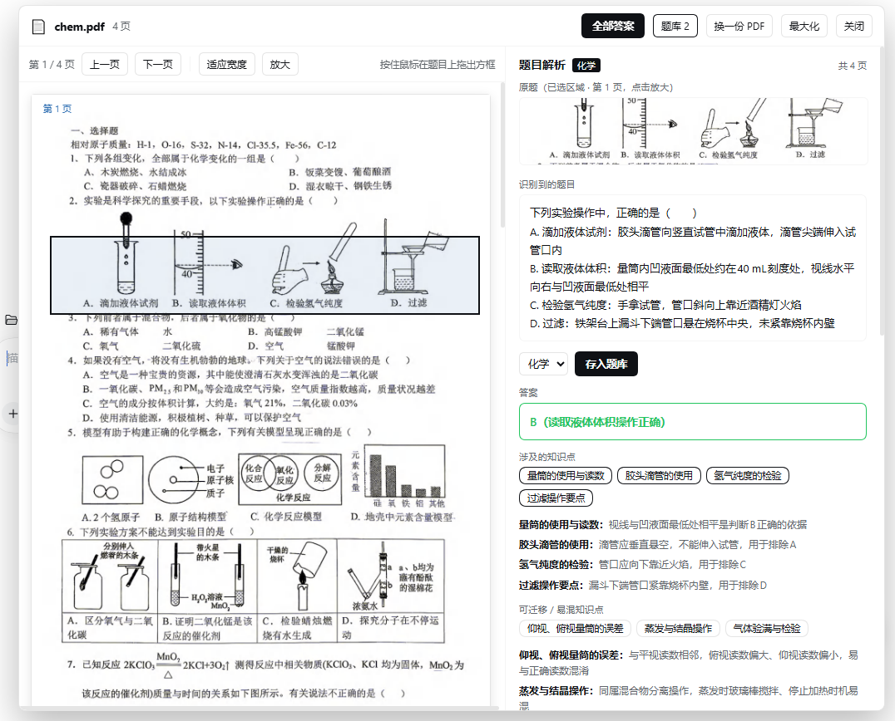
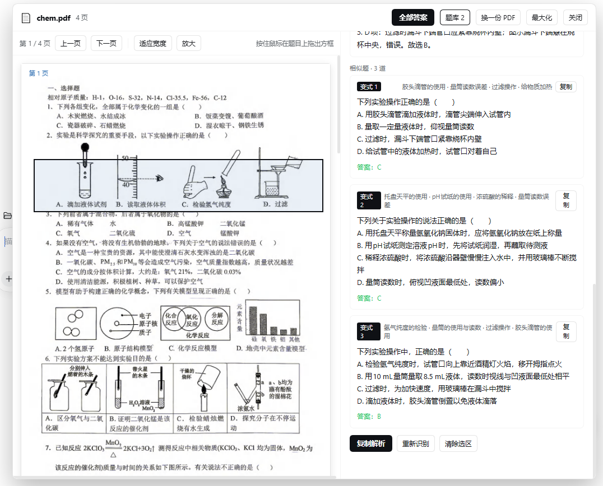
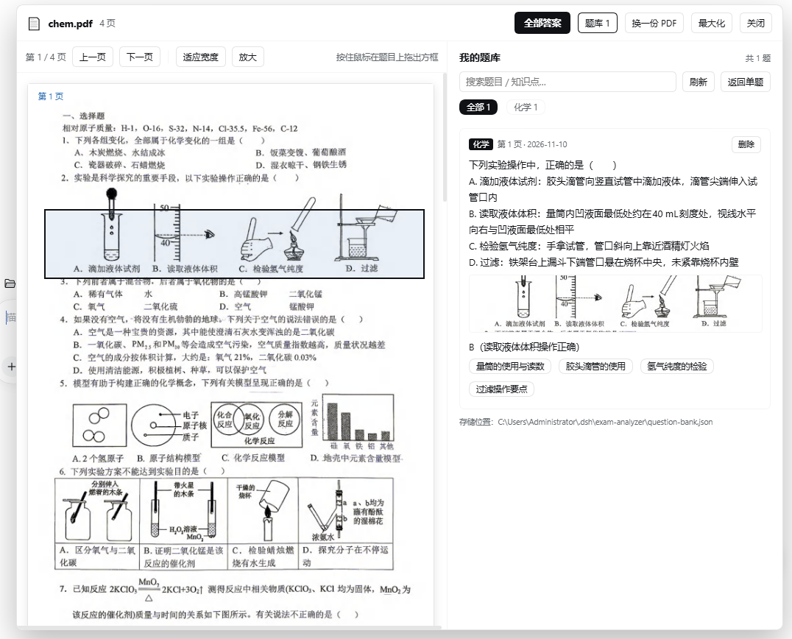

# 试卷解析镜 · Exam Lens

> 导入 PDF 试卷 → 鼠标框选一道题 → 右侧立刻给出**答案、知识点、可迁移知识点、分步解析、相似题**。

面向初中理科（数学 / 物理 / 化学）的 DSH 插件：保留原始试卷版面，按题框选，逐题解析。


## 界面

左侧是试卷原图，框选一道题，右侧立刻出结果：



<p align="center">
  
  
</p>

<p align="center"><sub>左：3 道相似题（含完整选项与答案）　右：按学科分类的本地题库</sub></p>

---

## 功能

- **原版式阅读**：浏览器端用 pdf.js 逐页渲染 PDF（扫描件、矢量 PDF、图文混排都行），左侧就是试卷原样。
- **框选即解析**：拖一个框把题干和选项圈进去，右侧输出
  `原题截图（点击放大）→ 识别到的题目 → 答案 → 知识点 → 可迁移知识 → 分步解析 → 3 道相似题（含选项与答案）`。
- **学科自适应**：自动判断数学 / 物理 / 化学，化学会要求配平、标条件、化学式用下标。
- **图形题不再瞎猜**：分析时**原图与转录文字一起送模型**，车标、装置图、几何图以图片为准；相似题若依赖图形，会用文字把图形描述清楚，并给出 SVG 示意图。
- **全卷答案**：一页一次调用，整页 2200px 高清重渲染，按「第 n 页」列出题号 + 答案。
- **本地题库**：按学科分类、关键词搜索、缩略图放大；**只保存题目里的图形**（模型定位后裁剪，最多 3 张），题干以文字入库。
- **排版细节**：根号有上横线、分数上下堆叠；复制出来仍是纯文本。

## 安装

零运行时依赖（pdf.js 已内置在 `vendor/`）。

### 方式一：tgz（推荐）

```text
plugin_manager  action=install_bundle  target=D:\plugins\exam-analyzer-1.2.0.tgz
```

### 方式二：克隆仓库后直接用目录

```bash
git clone https://github.com/codeforbuddy/exam-analyzer.git
```

```text
plugin_manager  action=install_bundle  target=<仓库目录的绝对路径>
```

装完刷新页面（Ctrl+R），右下角出现「📄 试卷解析」。

### 环境要求

- DSH ≥ 1.2（需要 `shell.overlay` 槽位、`attachments` 与 `llm` 服务）；
- 当前会话模型需支持图片输入（如 `deepseek-flash`，可用 `GET /api/exam-analyzer/model` 查看）。

## 使用

1. 点右下角「📄 试卷解析」→ 选择或拖入 PDF；
2. 左侧翻到要做的题，在题目上按住鼠标拖框（题干 + 选项一起框最准）；
3. 右侧看答案、知识点、解析、相似题；
4. 想整理错题：选学科 → 「存入题库」，之后点顶部「题库 N」检索。

题库位置：`~/.dsh/exam-analyzer/question-bank.json` + `images/*.png`（纯 JSON，可备份可迁移）。

## 已知限制

- 标签页最小化时 PDF 渲染暂停，切回前台继续；单份最多 40 页，首屏约 1 秒/页。
- 相似题里的 SVG 示意图是模型按题意画的，仅供参考，精确图形以原题为准。
- 题库里的图按「上/下/左/右/整图」方位裁剪，复杂版面可能带一点邻近文字。

## 开发

```text
index.js           Host 端：pdf.js 静态资源、/analyze、/solve-page、/locate-figure、/bank/*
client.js          Web 端：shell.overlay 面板、pdf.js 渲染、框选、结果渲染
cordis.patch.yml   插件注入配置
vendor/            pdf.js（内置，勿删）
locale/            中英文案
dist/              打好的 tgz / zip
```

接口与容错细节见 [README.md 的实现章节](./README.md#实现)（即本文件下方内容）。

## License

MIT，见 [LICENSE](./LICENSE)。
